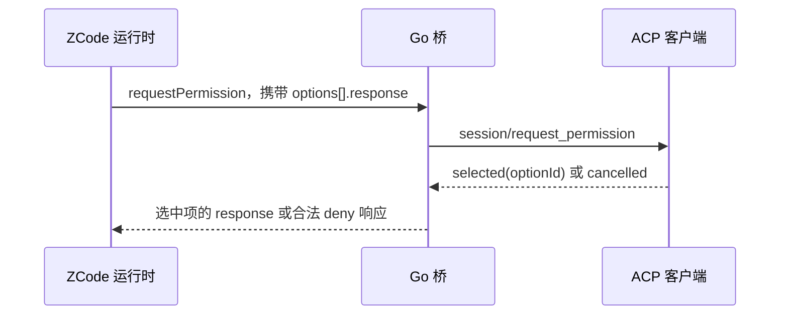

# 开发入口与任务顺序

更新：2026-09-27。状态：T01～T04 实现完成，fake 契约测试与真机验证均已通过；日常入口真机验证完成（见文末 2026-09-27 记录）；T05 及以后尚未实施。

本文件记录后续开发任务，不改变 `PORTING_PLAN.md` 中早期 Python → Go 移植的历史结论。

## 已确定的要求

- 对外以标准 ACP 为基础，支持范围必须通过能力声明与契约测试明确；不把实现所有可选能力当作符合 ACP 的前提。
- 去掉对 omnigent 私有交互约定的依赖。ZCode 专有功能使用 `_zcode/` 扩展；额外数据只放在协议允许的 `_meta` 中，并协商扩展能力。
- 后续 ZCode、Claude Code、Codex 适配器放在同一仓库；公共层以实际共用的协议职责为边界，当前先完成 ZCode 链路。
- 适配器驱动 ZCode 官方运行时，并承担必要的宿主职责；会话主链路向 v4 迁移，管理方法按真实后端能力处理。
- 经 ZCode 服务端执行任务享受 50% 实扣优惠是用户确认的服务端政策，不作为待验证事项，也不在桥内修改 usage 或实现折扣计算。
- 后续支持账号套餐、Start Plan 模型选择、定时任务和闲时任务。

## 事实依据

- Go 桥基线：`5909f66`。已有初始化、会话、流式翻译、取消与部分扩展方法。
- 本地 ZCode 源码基线：`29628c9`，版本 3.14.3；源码位于相邻的 `projects/agents/ZCode` 仓库。
- ZCode 权限请求选项由 `packages/shared/src/zcode-protocol/index.ts` 的 `zcodePermissionOptionSchema` 定义，形状为 `optionId / kind / name / response`。
- 当前 `internal/bridge/permission.go` 回传 `action / optionId`，没有回传选项携带的权限响应。
- 当前 `test/e2e/ask_test.go` 的 `TestPermissionAllowed` 使用 `id / label` 假数据，并断言旧的 `action / optionId`，不能作为真实权限契约正确性的证明。
- 当前 `internal/bridge/ask.go` 依赖把多选及自由文本放进 `optionId` 的私有约定。

## 任务清单

所有状态均表示实现状态；写出计划不等于任务完成。

| ID | 交付范围 | 依赖 | 状态 |
|---|---|---|---|
| T01 | 工具权限请求与应答对齐真实 ZCode schema；修正契约测试 | 无 | 完成（fake 契约测试 + 真机 allow_once/allow_project/deny 三分支通过，见交付记录） |
| T02 | 交互请求按会话和 requestId 去重；补齐等待中的取消、超时与断连处理 | T01 | 完成（去重经真机验证不成立、已在交付记录写明；取消/超时/并发三项已实现，见交付记录） |
| T03 | 明确问答能力协商；修复 plan 审批的 value 映射；移除 omnigent 私有答案编码 | T02 | 完成（协商 + 收紧降级；plan 审批 value 映射经真机双路径验证，zcode 收到 `"approve"`） |
| T04 | 审核 ACP 方法、能力声明、模式及模型配置展示；专有方法收敛到扩展边界；补齐已声明能力的测试 | T03 | 完成（能力声明经规范核对全部成立；标准 `session/set_mode`/`session/set_config_option`、`modes`/`configOptions` 投放与 `_zcode/` 扩展声明已实现，见 T04 交付记录） |
| T05 | ZCode v4 会话链路：命令、快照/增量、断档恢复、分片、交互与 ACP 更新翻译 | T04 | 待开始 |
| T06 | 账号权益与请求鉴权；Start Plan 模型选择及完整任务执行 | T04 | 待开始 |
| T07 | 持久化定时任务与常驻调度，复用已验证的会话执行入口 | T06 | 待开始 |
| T08 | 官方闲时取号、排队、派发、票据过期续跑与结束核销 | T07 | 待开始 |

T05 与 T06 没有必然的先后依赖；各自开工前按当前后端能力确定交付顺序。迁移到 v4 本身不会提供账号或调度服务。

T03 开工时核对当前 ACP 规范与本项目 SDK。普通问答不能默认等同于工具授权；实验性 elicitation 或 `_zcode/` 问答扩展只有在客户端声明相应能力时使用。缺少表达能力时给出明确结果，不能默默截断多选或把任意文本解释成授权。

## 第一个任务：T01 工具权限契约修复

### 可观察的完成标准

标准 ACP 客户端收到工具权限请求并作出选择后，ZCode 收到对应选项携带的合法权限响应。允许一次、持久允许、拒绝、取消和非法选择都有明确结果。

### 状态与责任

- ZCode 生成可选权限决策及持久权限规则。
- ACP 客户端返回用户选择的选项 ID 或取消结果。
- 桥保存本次请求的选项映射，校验返回的 ID，并转换响应；桥不自行扩大权限，也不自行写 ZCode 的权限配置。



### 实施顺序

1. 读取上述 ZCode schema、权限响应定义和实际选项构造代码，核对 ACP 权限类型；确定允许范围与 kind 映射。
2. 用真实结构替换 `TestPermissionAllowed` 的旧 fixture，新增下面的关键场景。先只改测试，记录当前实现的失败。
3. 修改 `internal/bridge/permission.go`：使用 `optionId / name / kind`，将选中的原始 `response` 回传给 ZCode，保留 `permissionUpdates`。
4. 取消、超时、未知 ID 和不可用选项返回合法拒绝响应；客户端没有选择有效允许项时，不能授予权限。
5. 运行权限场景测试，再运行仓库全量检查；补充验证结果后更新任务状态。

### 必须覆盖的场景

| 场景 | 预期结果 |
|---|---|
| 允许一次 | ZCode 收到该选项的合法 `response` |
| 持久允许 | 权限更新字段完整保留，ACP 展示的 kind 与授权范围一致 |
| 选择拒绝项 | 回传拒绝项的响应，不把所有选项都标成允许 |
| 客户端取消或交互超时 | ZCode 收到合法 deny，等待结束 |
| 客户端返回未知 optionId | 不授予权限，返回合法 deny |
| 缺少有效选项或选项结构非法 | 不合成允许决策，不发送非法响应 |

重复请求、等待中取消整个 turn、断连时的交互清理属于 T02；T01 完成不能据此宣称人在回路全链路已经完成。

### 验证命令

```sh
# 先验证新测试能暴露旧实现的问题，再修改实现并重跑。
go test -count=1 ./test/e2e -run '^TestPermission'

# Makefile 定义的仓库检查：依次执行 go vet ./... 和 go test ./...。
make test
```

若修复新增了其他包的测试，执行对应测试。T02 涉及并发状态时增加针对性的 race 检查。真机验证单独记录后端版本、客户端与实际走过的权限分支；fake 测试通过不等于真机通过。

## 每个任务的交付记录

- 实施前写明输入/输出、错误路径、涉及文件和验收场景；遇到新的协议事实先修订任务范围。
- 对行为修复保留可失败的契约测试，不用旧实现的输出反推正确答案。
- 完成后记录代码变化、执行过的检查、真机验证范围及剩余问题，再更新清单状态。
- T01 已修复并完成真机验证（见下方交付记录），本机已安装的二进制未替换。
- T02 的去重一项真机验证后不成立、未实现，依据见下方 T02 交付记录。
- T03 的降级路径**不再支持多选与自由文本**。这是计划表明确要的行为（不能默默截断多选或把
  任意文本解释成授权），但对 omnigent 这类靠 permission 表单拿问题的客户端是**行为变更**，
  详见 T03 交付记录的能力损失一节。

### 开工基线（2026-09-26）

- `make test` 已执行，退出码 0：`go vet ./...` 与 `go test ./...` 均通过。
- 此结果只证明已有测试通过；权限测试仍使用上述错误契约，T01 的修正测试尚未编写。
- 未运行真机冒烟，未发起模型请求。

## T01 交付记录（2026-09-26）

### 协议事实（开工时核对，本地 ZCode 源码基线 `29628c9` / 3.14.3）

- `zcodePermissionOptionSchema`（`packages/shared/src/zcode-protocol/index.ts:590`，`.strict()`）：
  `optionId / kind / name / description? / response`。
- `zcodePermissionResponseSchema`（`packages/shared/src/zcode-protocol-legacy-types.ts:65`，`.strict()`）：
  `decision ∈ {allow, deny, escalate, modify}`、`reason?`、`modifiedInput?`、
  `permissionUpdates?: [{type:"addRules", behavior: allow|deny|ask, rules:[{toolName, ruleContent?}]}]`。
- `interaction/requestPermission` 的应答就是上面这个 schema：broker 以它作为
  `requestClient` 的第三参校验（`apps/zcode-cli/packages/bootstrap/src/zcode-protocol/interaction-broker.ts:76`）。
  旧实现回 `{action, optionId}` 既不是合法 PermissionResponse，也丢掉 `permissionUpdates`。
- 选项列表由 `buildProtocolPermissionOptions`
  （`apps/zcode-cli/packages/bootstrap/src/permission-options.ts:37`）合成，kind 闭集为
  `allow_once` / `allow_session` / `allow_always` / `deny`；`allow_always`（optionId
  `allow_project`）的 response 携带持久 `permissionUpdates`，`allow_session` 不带。
- ACP 侧 `PermissionOptionKind` 是闭集 `allow_once | allow_always | reject_once | reject_always`，
  outcome 是 `cancelled` 或 `{selected, optionId}`（agentclientprotocol.com/protocol/schema）。
  ACP 没有会话级槽位；ZCode 自己的 v4 投影把 `allow_session` 映到 `allowAlways`
  （`zcode-protocol-v4/product-projection.ts:3165` 注释），桥沿用同一做法。

### 代码变化

- `internal/bridge/permission.go`（重写）：按 `optionId / name / kind` 投放选项，
  回传**选中项 response 原文**（`permissionUpdates` 随之保留）；桥不再合成
  `Allow once`/`__reject__` 兜底选项，不再解析 `id`/`label`，不再回 `{action, optionId}`。
  映射与降级：取消、超时、未知 optionId、空 optionId、非 selected、无有效选项
  一律回 `denyPermissionResponse`（`{decision:"deny", reason:…}`，文案与 ZCode 的
  `buildPermissionDeniedContent` 逐字一致，模型才知道工具没执行）。
  `escalate`/`modify` 的选项不投放 —— ACP kind 闭集表达不了，展示出来会让用户
  以为点了「拒绝」而实际是别的决策；全都不可表达时直接回 deny。
  选项的 `description`、请求的 `riskLevel`/`reason`/`origin`、每个选项的真实
  zcode kind 放进协议保留的 `_meta`（不塞进嵌套选项，避免客户端 strict 校验）。
- `test/e2e/permission_test.go`（新增）：16 个用例，fixture 复刻真实 schema 形状。
  替换 `test/e2e/ask_test.go` 里用 `id/label` 假数据、断言旧 `action/optionId` 的
  `TestPermissionAllowed`。
- `test/e2e/passthrough_test.go`：`startScriptedEnv`（超时场景注入环境变量）。
- `test/e2e/e2e_test.go`：`acpClient.request` 超时/写失败改为返回 error 帧而不是
  `t.Fatalf`。原实现在 prompt 的 goroutine 里超时会把整个测试二进制 Goexit 掉，
  吞掉其余用例的失败（改造过程中实测到）。
- `test/smoke/permission_test.go`（新增，`-tags=real`）：真机权限分支驱动，
  从线材日志取桥回给 zcode 的那一包断言。**从未跑通过**，见下。

### 执行过的检查

- `go test -count=1 ./test/e2e -run '^TestPermission'` — 通过（37.5s）。
- 先只改测试、跑旧实现，16 个用例**全部失败**，逐条对应上面的契约问题；据此确认
  测试有鉴别力，不是把旧实现的输出当正确答案。记录摘录：
  - `选项数 = 4, want 3`（旧实现多投了合成的 `__reject__`）；
  - `持久允许的 kind = allow_once, want allow_allow`（旧实现把所有选项都标成允许）；
  - `zcode 应收到会话选项的 response 原文: map[action:accept optionId:allowSession]`
    （旧实现回的不是 PermissionResponse）；
  - 取消/超时/未知 ID 三例均得到 `map[action:reject]`，`decision` 为 nil。
- `make test`（`go vet ./...` + `go test ./...`）— 退出码 0。
- `go test -count=1 -race ./test/e2e -run '^TestPermission'` — 通过（T01 不涉及并发
  状态，顺手跑一次；T02 仍需针对性的 race 检查）。
- `gofmt -l`（排除 `upstream/`）无输出；`go vet -tags=real ./test/smoke/` 通过。

### 真机验证范围

本机 ZCode 3.14.3（`/Applications/ZCode.app`，与源码基线 `29628c9` 同版本），
`go test -tags=real ./test/smoke -run TestSmokeRealPermission`。三个分支各跑一次，
全部 PASS，单次 22–26 秒。

- **模型回合已跑通**（此前记录为"无法完成任何模型回合"，已不成立）。会话模型目录
  来自 provider 配置，与账号实际可用模型不匹配。根因是 **CLI 认的 provider 配置和
  App 登录写进 `config.json` 的凭证不是一回事**：CLI 只读
  `ZCODE_PERSONAL_PROVIDER_CONFIG_FILE`（`~/.zcode/v2/provider_config.json` 的
  `config.providerConfigRules.providerRules`）和
  `ZCODE_BUILTIN_PROVIDER_CONFIG_FILE`，**不读** App 的 `config.json` 的 `provider`
  map。`scripts/make-smoke-provider-config.py` 生成一份独立的 personal 配置
  （默认 `/tmp/zcode-smoke-provider.json`，0600），追加一条
  `group: "standard-personal"` 指向 `open.bigmodel.cn/api/anthropic` 的 rule，
  模型目录 19 → 21 个，回合正常结束（`stopReason: end_turn`）。
  **`~/.zcode/v2/provider_config.json` 未被改动**，凭证只从本机 `config.json` 读进
  输出文件、从不打印、没有写进仓库或文档。
  三条踩过的坑：providerId 必须是合法 `uuid4`（38 字符的假 id 会让整个目录塌成 0 个
  模型）；`group` 必须是 `standard-personal`，用 `bigmodel-family` 同样塌成 0 个；
  重复运行脚本要复用上次输出的 providerId，否则照打印结果导出的 `ZCODE_ACP_MODEL`
  下次就失效。
- **权限请求真实发生**，`build` 模式下的 `Bash` 触发的是
  `checkPermission` 的 `mode.build.highRisk` 分支 —— `_meta.zcode.reason` 回读为
  ZCode 自己的原文 `High risk tools require explicit approval`，
  `riskLevel=high`、`toolName=Bash`。
- **后端给出的三个选项与 T01 映射逐条吻合**：

  | optionId | ZCode kind | ACP kind | name |
  |---|---|---|---|
  | `allow_once` | `allow_once` | `allow_once` | Allow once |
  | `allow_project` | `allow_always` | `allow_always` | Always allow in this project |
  | `deny` | `deny` | `reject_once` | Deny |

  注意 ZCode 的 v3 投影**不投放** `allow_session`（`interaction-broker.ts:65`
  注释：会话免确认只在 v4 投放），所以真机上看到的只有三项；桥对
  `allow_session` 的处理只经过 fake 契约测试。
- **桥回给 ZCode 的应答**（从线材日志取出，与旧实现的 `{action, optionId}` 对照）：

  | 分支 | ZCode 实际收到 |
  |---|---|
  | `allow_once` | `{"decision":"allow","reason":"Approved once"}` |
  | `allow_project` | `{"decision":"allow","reason":"Approved for this project","permissionUpdates":[{"type":"addRules","behavior":"allow","rules":[{"toolName":"Bash","ruleContent":"touch <ws>/t01-permission-probe.txt"}]}]}` |
  | `deny` | `{"decision":"deny","reason":"The user doesn't want to proceed with this tool use. …"}` |

- **持久允许真的落地了**：ZCode 解析该 `permissionUpdates` 后自己把规则写进
  `~/.zcode/cli/db/db.sqlite` 的 `local_setting(scope='project',
  scope_id='proj_tmp-t01-perm-proj', key='ruleset')`，值即上面那条
  `{toolName:"Bash", ruleContent:"touch …"}`。这是 `permissionUpdates` 透传
  端到端生效的直接证据 —— 旧实现在这里会丢字段，规则根本不会被写。
- **副作用已清理**：删除该 `local_setting` 行与 `/tmp/t01-perm-proj` 后，
  `namespace='permission'` 的行集与开工基线 diff 为空（20 行）。
  `allow_once` / `deny` 两跑不写任何规则。本机已安装的二进制未替换。
- **仍不在本轮范围**：重复请求去重、等待中取消整个 turn、断连清理（T02）；
  `escalate` / `modify` / `allow_session` 三个选项的真机路径（见剩余问题）。

### 剩余问题

1. **`escalate` / `modify` 选项在 ACP 里无法表达**，桥选择不投放。这是取舍而非缺陷，
   但如果 ZCode 后续把这两类决策用于常规路径，需要在 T03/T04 重新评估。
2. workflow `Refine` 选项（`workflowRefine`，v4 投放）的 response 是普通 deny，
   桥会原样回传；ZCode broker 依赖 freeText 才升级成带反馈的拒绝，而 ACP 的
   `RequestPermissionOutcome` 没有自由文本字段，这层反馈在 T01 无法表达。
3. `allow_session` 在 ACP 闭集里被映成 `allow_always`（与 ZCode v4 投影一致），
   真实作用域靠 zcode 的 `name`/`description` 和 `_meta` 呈现。若客户端只按 kind
   决定文案而不读 name，展示会偏宽。真机 v3 路径不投放该选项，未走到。
4. **冒烟探针命令不能是只读的。** ZCode 对通过
   `isRuntimeReadOnlyBashCommand` 的 bash 命令降级能力
   （`handlers/bash.ts` `resolveBashPermissionCapability` → `readOnly:true /
   needsApproval:false`），`build` 模式随即命中 `checkBuildMode` 第一条
   `mode.build.readOnly` 直接放行，**根本不会发起权限请求**。`echo` 在只读白名单里
   （`bash-readonly-policy-simple-commands.ts` 的 `allowAnyArgs`），拿它当探针会
   永远等不到 `requestPermission` —— 排查初期在这上面绕了很久。测试已改用
   `touch`，并把原因写进代码注释。
5. **模型可用性依赖 `scripts/make-smoke-provider-config.py` 生成的 provider 配置**，
   见上面「模型回合已跑通」。用户自己的 `~/.zcode/v2/provider_config.json` 本轮刻意
   没改；要把该 provider 长期固化，需手工把生成文件里的那条 rule 并进去。
   `open.bigmodel.cn` 上**不存在** start-plan 端点（catalog 映射 + 三次 404 已确认），
   start-plan 与 off-plan 一律走 `zcode.z.ai`。
6. **真机冒烟必须带 `-count=1`。** 换环境变量重跑时 `go test` 有时命中缓存直接回上次
   结果（输出出现 `(cached)`），日志里的 pid / sessionId 全是上一次的，看着像跑过了
   其实后端根本没启。已踩过一次，写进了 `test/smoke/permission_test.go` 的说明。


## T02 交付记录（2026-09-26）

### 开工时确认的三个缺口

计划表把 T02 写成「去重 + 补齐取消/超时/断连」。读代码后确认这三项的证据强度完全不同，
其中两项有确凿的代码级证据，去重没有 —— 所以先做了真机验证再决定实现与否。

1. **等待中的 `session/cancel` 完全不生效（确凿）。** `handlePermission` /
   `handleUserInput` 是在 turn 循环的 `case req := <-l.Requests:` 里**同步**执行的
   （原 `turn.go:116-125`），等答案期间循环停在 case body 里，`case <-turn.cancel`
   得不到服务。`handleSessionCancel`（`session.go:319`）在读循环 goroutine 里
   `close(turn.cancel)`，确实执行了 —— 但没人在听。最坏阻塞 `compat.Question`
   = **10 分钟**。
2. **放弃等待时客户端请求悬空（确凿）。** 超时/取消/断连三条路径上 `jsonrpc.Request`
   会 `dropPending`（pending map 本身不泄漏，这点没问题），但桥**单方面放弃**，
   客户端那条 `session/request_permission` 永远收不到应答，客户端 UI 挂死。
   T01 的 `TestPermissionTimeout` 只断言了 zcode 侧收到 deny，漏掉的正是这一半。
3. **同会话并发 prompt 静默抢占 listener（确凿）。** `runTurn` 在 subscribe + send
   **之后**才注册 `br.turns`（原 `turn.go:60-63`），而 `RegisterListener`
   （`backend.go:686`）对同一 sid 直接覆盖、只打一条警告。第二个 prompt 从这个窗口
   插进来就会抢走 listener，第一个 turn 的权限请求随即被当成「无在飞 turn」
   自动 cancel —— 用户视角是第一个 turn 的授权被无故拒绝。
4. **去重：真机验证后不成立**，见下节。

### 步骤 0：去重的真机验证（结论：不实现）

一次性探针（`/tmp` 下，不入库），provider 配置由 `scripts/make-smoke-provider-config.py`
生成，模型 `GLM-5.3-Flash`，`build` 模式，两次独立跑：

**探针 A —— 一个 turn 内两次不同的工具调用。** 提示词要求依次执行
`touch /tmp/t02-probe-a.txt` 与 `touch /tmp/t02-probe-b.txt`，各发一次权限请求，
客户端两次都选 `allow_once`。线材日志（`zcode→bridge` 的 `interaction/requestPermission`）：

| rpcId | requestId | toolCallId | turnId | input.command |
|---|---|---|---|---|
| `server-4` | `perm_3a2eb157-…-3f5b32332f3f` | `call_6ef460c9…` | `turn_52b98711-…` | `touch /tmp/t02-probe-a.txt` |
| `server-5` | `perm_696ae871-…-f36e167f3dc3` | `call_e0cd5f10…` | `turn_52b98711-…` | `touch /tmp/t02-probe-b.txt` |

同一 `turnId` 下两个请求的 `requestId` 与 `toolCallId` **都不同** —— 是两件不同的
事，不是同一件事问两遍。

**探针 B —— 两次逐字相同的调用，第一次选 `allow_project`。** 提示词要求把
`touch /tmp/t02-probe-dup.txt` 执行两次、分成两次独立工具调用。结果：**只投了 1 次
权限请求**（`perm_adafd295-…-67f11b1d714c`），第二次调用被 zcode 自己的规则引擎直接
放行，`stopReason: end_turn`。

`allow_project` 的持久规则确实落库了（这同时是 T01 `permissionUpdates` 透传的第二次
独立验证）：

```
project|proj_tmp-t02-probe-ws|ruleset|{"version":1,"allow":[{"toolName":"Bash","ruleContent":"touch /tmp/t02-probe-dup.txt"}]}
```

**结论：zcode 不重投同一 `requestId`，重复调用由它自己的规则引擎吸收，压根到不了桥。**
按 T01 的教训（拿只读命令当探针永远等不到权限请求）先验证再实现的判断是对的 ——
如果照计划直接写去重登记表，就是给不存在的问题加代码。所以 T02 **没有实现去重**。
若将来真观测到同一 `requestId` 重复投递，再按 `(zcode 会话, requestId)` 加登记表，
且要重新审视：真正的重复源更可能在桥自己的重试或 v4 链路上，而不是 v3 的 broker。

**副作用已清理**：删除 `proj_tmp-t02-probe-ws` 行与 `/tmp/t02-probe-ws` 后，
`namespace='permission'` 的行集回到 20 行（与 T01 收尾基线一致）。探针脚本与
线材日志已删除。

### 代码变化

- `internal/jsonrpc/jsonrpc.go`
  - `pending` 的值从裸 channel 换成 `*pendingReq{ch, once atomic.Bool}`。
    客户端应答与放弃路径抢同一个 CAS：只有一方能对同一 id 写结果帧，输的一方
    丢弃并打 `[late-reply]` 日志。**没有这个 CAS 的话，放弃路径补写的 `cancelled`
    可能和客户端恰好同时到达的应答撞成同一 id 两帧**（JSON-RPC 违规）。
  - 新增 `ReplyResult(id string, result any) error`：给已放弃的请求补写结果帧。
  - 新增 `RequestAbandonable(ctx, method, params, out, onAbandon func(id))`；
    现有 `Request` 改为它的薄封装（`onAbandon` 传 nil），**所有既有调用点签名不变**。
    放弃时先 `dropPending` 再调 `onAbandon`。
- `internal/bridge/interaction.go`（新增）：`permOutcome`（原先 `askOne` 与
  `handlePermission` 各自内联了一份完全相同的结构体）与 `askClient`。`askClient`
  走 `RequestAbandonable`，`onAbandon` 里给客户端补
  `{"outcome":{"outcome":"cancelled"}}` —— ACP 里「这次授权作废了、什么都没批」
  的规定说法。
- `internal/bridge/ask.go` / `permission.go`：两条路径都改用 `askClient`，删掉各自
  的 `permReply` 副本与重复的 `context.WithTimeout(Question)`（超时上限现由
  `askClient` 统一施加）。`handlePermission` 的 deny 文案区分取消与超时
  （`the turn was cancelled while waiting for the permission answer`）。
- `internal/bridge/session.go`：`activeTurn` 增加 `abort context.CancelFunc`；
  `handleSessionCancel` 在同一个 `cancelOnce` 里既 `close(turn.cancel)` 又调
  `turn.abort()`。
- `internal/bridge/turn.go`
  - 新建 `interactCtx, abort := context.WithCancel(ctx)`，存进 `activeTurn`；
    循环里 `handleUserInput` / `handlePermission` 改收 **`interactCtx`** 而不是裸
    `ctx`。`turnCtx`（`finishTurn` / `waitForCancelled` 用）不动。取消后循环下一轮
    命中已关闭的 `case <-turn.cancel`，走既有的 `stopBackendTurn` +
    `waitForCancelled` 收尾，语义不变。
  - **turn 注册从 subscribe+send 之后前移到 `runTurn` 最前面**，顺带关掉
    `RegisterListener` 被抢占的窗口；同位置加 `br.mu` 守卫，已有在飞 turn 时返回
    `-32600`（文案说明是并发 turn）并**不碰后端**。`defer delete` 保持，任何提前
    返回都会释放。`RegisterListener` 的覆盖警告保留作兜底。
- `test/fakeserver/main.go`：`action` 增加 `delayMs`（写响应前先睡）。用来把
  `session/send` 撑到确定性宽度，让并发用例稳定落在旧实现的注册窗口里。
- `test/e2e/interaction_test.go`（新增）：4 个用例，见下。
- `test/e2e/passthrough_test.go`：`fakeAction` 同步加 `DelayMs`。

### 执行过的检查

- `go test -count=1 ./test/e2e -run 'TestPermission|TestInteraction|TestConcurrent|TestAsk'`
  — 通过（54.5s，19 个用例）。
- `go test -count=1 -race ./test/e2e` — 通过（68.5s）。T02 动并发状态，race 是必须的。
- `make test`（`go vet ./...` + `go test ./...`）— 退出码 0。
- `gofmt -l`（排除 `upstream/`）无输出；`go vet -tags=real ./test/smoke/` 通过。
- **新用例的鉴别力**：只回退实现、保留测试（`askClient` 改回 `Request`、
  去掉 `turn.abort()`、交互改回裸 `ctx`、turn 注册挪回 send 之后），4 个用例
  **全部失败**，逐条对应上面的缺口：

  | 用例 | 旧实现下的失败 |
  |---|---|
  | `TestInteractionCancelDuringPermission` | `等待桥给 brq-1 补结果帧超时 —— 客户端这条请求会一直悬着` |
  | `TestInteractionCancelDuringAsk` | 同上 |
  | `TestPermissionClientAnsweredOnTimeout` | 同上 |
  | `TestConcurrentPromptRejected` | 第二个 prompt 拿不到 `-32600`，而是挂到测试自身的超时（fake 串行处理，第二个 `session/send` 根本收不到应答 —— 这正是静默抢占的症状） |

  取消/超时用例都注入 `ZCODE_ACP_QUESTION_TIMEOUT`，没修好的话是「断言失败」而不是
  整个测试挂满 10 分钟。

### 真机验证范围

- **回归**：`go test -count=1 -tags=real ./test/smoke -run TestSmokeRealPermission`
  （`allow_once`）— PASS，21.0s。zcode 实际收到
  `{"decision":"allow","reason":"Approved once"}`，与 T01 记录逐字一致。
  `-count=1` 不可省（见 T01 剩余问题 6）。`namespace='permission'` 仍为 20 行。
- **步骤 0 的两次探针**（见上），已清理干净。
- **未在真机上验证**：
  - 断连路径。fake 侧没有「客户端进程中途消失」的场景，本轮只覆盖了取消与超时
    两条放弃路径；断连走的是同一个 `ctx.Done()` 分支（`interactCtx` 派生自连接
    ctx），但没有独立证据。
  - 真机上 `session/cancel` 打断在飞权限请求的端到端时序（fake 上已覆盖，真机上
    未构造）。
  - `interaction/requestUserInput` 在真机上根本没被触发过 —— ZCode 3.14.3 的
    v3 路径不主动反问，`TestInteractionCancelDuringAsk` 只有 fake 证据。

### 剩余问题

1. **`TestConcurrentPromptRejected` 依赖 300ms 睡眠与 1500ms fake 延迟的相对关系。**
   在极慢的机器上第二个 prompt 有可能排到第一个 turn 之后而测不到并发。当前配比
   （1.5s 窗口 / 300ms 偏移）留了 5 倍余量，race 模式下也稳定，但这是时序测试的
   固有脆弱点，不是确定性的。
2. **并发 prompt 现在是硬拒绝（`-32600`），不是排队。** 客户端若真的并发发 prompt，
   第二个会失败。zcode 一次只跑一个 turn，排队没有后端语义支撑；但如果将来有客户端
   依赖「发了就有回音」，需要的是客户端侧重试而不是桥侧排队。
3. **去重的登记表没有实现**（依据见步骤 0）。真机两次探针都没观测到重复投递，
   照计划实现等于给不存在的问题加代码。保留这条记录是为了：将来若观测到重复，
   知道该往哪儿看。
4. **断连清理未验证**（见真机验证范围）。桥侧的 `defer` 与 `wg.Wait` 保证进程能退出，
   但「客户端消失后 zcode 侧收到什么」没有证据。


## T03 交付记录（2026-09-26）

### 开工时确认的三个缺口

计划表把 T03 写成三件事。读代码 + 核对当前 ACP 规范（v1，`protocol/v1/elicitation`、
`protocol/v1/schema`）后确认三项都是真问题，且互相咬合。

1. **plan 审批的 value 映射 —— 确凿的 bug，用户点「批准」等于没批准。**
   plan 审批（`ExitPlanMode`）走的是 `interaction/requestUserInput`，**不是**
   `requestPermission`：`interaction-broker.ts:48-53` 的 `requestPermission` 分发器
   按 `toolName` 分流，`EXIT_PLAN_MODE_TOOL_NAME` 走
   `requestExitPlanModeApproval`（`:269`）。它投放的问题由
   `createExitPlanModeApprovalQuestion`（`:326`）生成，选项是：

   ```ts
   { description: "Exit plan mode and start implementation.",
     label: "Approve",                       // ← 给人看的
     value: "approve" }                      // ← 给机器看的
   ```

   而 `planApprovalResponseToBrokerResult`（`:399`）经 `normalizePlanApprovalAnswer`
   把答案与常量 `EXIT_PLAN_MODE_APPROVAL_APPROVE = "approve"`（`:40`）**逐字比对**。

   桥这边 `askOptions` 用 `optionId: label`、`answerFromPermission` 命中后返回
   **label**。于是用户在界面上点「Approve」，桥回给 zcode 的是 `"Approve"` ≠
   `"approve"` → 判为「不是批准」→
   `withPlanExitDeniedTurnStop`（`core/src/tool/executor/turn-control.ts:44`）把字面量
   `"Approve"` 当成用户反馈喂回模型。**批准计划会让 ZCode 告诉模型用户说了「Approve」。**

   旧 fixture（`test/e2e/ask_test.go`）里 `value == label`，所以测试永远抓不到 ——
   这个 bug 能活下来正是因为 fixture 恰好抹平了唯一的区分点。
2. **问答能力从未协商 —— 桥把问题伪装成工具授权。** `handleInitialize` 原本
   **完全忽略 `clientCapabilities`**；`handleUserInput` 把 `AskUserQuestion` 逐题发成
   `session/request_permission`，选项 kind 一律 `allow_once`，外加一个 `__cancel__`。
   即「普通问答 = 工具授权」，正是计划表禁止的。
3. **omnigent 私有编码 —— 两种，都能被滥用。**
   - **多选**：把 JSON 数组字符串塞进 `optionId`，靠 `strings.HasPrefix(optionID, "[")`
     识别。ACP 的 permission 协议里 `optionId` 必须是投放过的选项之一，返回数组是协议
     违规；且 zcode 侧 `normalizeAnswerValue`（`interaction-broker.ts:617`）本来就接受
     数组，正规客户端直接回数组即可，根本不需要这层编码。
   - **自由文本**：`answerFromPermission` 把**任何**未匹配的 `optionId` 当自由文本原样
     透传。在 permission 请求里这就是「把任意文本解释成用户的选择」。

   上游 `upstream/packages/acp-bridge/zcode-acp-bridge` 快照里**完全没有**这套问答
   桥接（`AskUserQuestion` / `requestUserInput` 零命中）——它是 `65d67b6` 从本地克隆
   f256268 引进来的，所以本任务就是移除一段从未上游化的私有约定。

### 已核对的 ACP v1 事实

- 客户端能力：`clientCapabilities.elicitation = {form?: {}, url?: {}}`。
  **`form` 必须显式存在且非 null 才算支持**（`elicitation.md`「Checking support」：
  *"Form support exists only when `form` is explicitly present and non-null … `{}` and
  `{"form":null,"url":null}` advertise no supported modes"*）。规范明确说明这与 MCP
  2026-07-28 的「空对象=仅 form」**故意不同**。
- 「Agents **MUST NOT** request a mode the Client has not advertised」；未声明的
  capability 一律视为不支持；未声明的 mode 会让客户端回 `-32602`。
- `elicitation/create`（form）：`{sessionId, toolCallId?, mode: "form", message,
  requestedSchema}`。`requestedSchema` 是**扁平对象**，property 限
  **primitive 与 enum**（`elicitation.md:101`「properties use the supported primitive and
  enum schemas」；`schema.md` 的 `ElicitationSchema` 写着 "must be primitive types"）。
- 应答：`{action: "accept"|"decline"|"cancel", content?}`，union 另有 `other`
  （`_` 前缀保留给实现）。「Agents **SHOULD** validate them again」。

### 决策（已与用户确认）

- **协商 + 收紧后的 permission 降级**：声明了 `elicitation.form` 走 `elicitation/create`；
  否则退回 `session/request_permission`，但收紧为「只接受合法 optionId（= zcode `value`）」，
  自由文本与 JSON 数组一律不认。现有多选题在降级路径上无法表达 → 明确失败给 zcode。
- plan 审批做真机验证。

### 一处偏离原计划：多选不用 `type: "array"`

计划里写的是「`multiSelect: true` → `{type:"array", items:{type:"string", enum:[values]}}`」。
实施时核对规范发现**这是非法的**：ACP form 模式的 property 只允许原始类型与 enum，
数组两者都不是；严格客户端会按 `-32602` 拒掉整个 `elicitation/create`，结果是
**每一个**多选题都被静默降级（比不做 elicitation 更糟 —— 表现为能力随机失效）。

改成**一个选项一个 boolean property**（`key[value]`，`title` 取 label，
`description` 取问题原文），语义与 checkbox 一致（省略 = 不选），且
`required` 只列单选题 —— 强制客户端为未勾选项回 `false` 是不合理的要求。
`TestElicitationSchemaUsesOnlyPrimitives` 把这条钉住。

### 代码变化

- `internal/bridge/elicitation.go`（新增）
  - `clientCaps` / `parseClientCaps`：严格按规范判定 `form` 是否被声明
    （`{}`、`{"form":null}`、整个 `elicitation` 缺省或为 null 一律为假）。
  - `askQuestion` / `parseAskQuestions` / `propName` / `properties` /
    `elicitationSchema`：zcode 的 `questions[]` 投影成一份扁平 `requestedSchema`。
    property 名优先取**问题原文**（zcode 的 `normalizeAskUserQuestionAnswers`
    首先按它取值），空或本请求内重复时退化为 `answer_<i>`（该回退路径 zcode 同样认）。
    **enum 取 `option.value`，展示名取 `option.label`** —— value 映射的修复就在这里。
  - `readAnswer`：agent 侧二次校验（规范要求 SHOULD）。单选必须命中 enum；多选逐个
    boolean 取，只认 `true`；一个 property 都不出现判为「这题没答」，与「一个都没选」
    区分开。
  - `askViaElicitation`：**一次** `elicitation/create` 问完整组问题。任一题缺失/非法
    → 整组放弃并回 cancel，而不是「丢弃那题、其余照收」—— 后者会产生标着 `accept`
    的不完整 answers，模型会当成用户确实只答了其余几题然后基于缺的那题往下编。
  - `askRequestMeta`：表单装不下的 zcode 事实（`requestId`/`toolName`/`header`/
    `preview`/`multiSelect` 与 label 映射）放进协议保留的 `_meta.zcode`。
- `internal/bridge/interaction.go`：`askClient` 泛化成 `askClientRaw(ctx, method, params,
  out, abandoned)`，两条问答路径共用这一个出口，**T02 的取消/超时/放弃语义只有一处**
  （放弃时 permission 路径回 `cancelled`，elicitation 路径回 `{action:"cancel"}`）。
  T02 的 `askClient` 签名与行为不变，作为薄封装保留。
- `internal/bridge/session.go`：`Bridge` 增加 `clientCaps` 字段；`handleInitialize`
  解析 `clientCapabilities` 并在 `br.mu` 下写入，日志打印 `elicitation.form=<bool>`。
  initialize 的**返回值不变**（不新增 `agentCapabilities` 声明 —— T04 统一审）。
- `internal/bridge/ask.go`
  - `askOptions`：`optionId` 改成 `option.value`（`name` 仍是 label）。value 为空/
    重复的选项不投放。
  - `__cancel__` 换成 `askCancelOptionID = "\x00zcode:ask-cancel"`。zcode 的
    `zcodeUserInputOptionSchema` 对 value 只要求非空字符串，理论上任何字符串都合法，
    所以不能只靠前缀「看起来不像」：`askOptions` **显式跳过**与它同值的选项，撞车在
    构造期就消掉（`TestAskOptionsNeverCollidesWithCancelSentinel`）。
  - `answerFromPermission`：**只认投放过的 optionId**，返回其 value。自由文本、
    JSON 数组、未知 id 一律拒绝并**显式记日志**（不再当自由文本透传）。
  - `handleUserInput`：按 `br.supportsElicitationForm()` 选路；降级路径**先预检全部
    问题**，任一题 `multiSelect: true` 或无可投放选项 → **一题都不问**直接回 cancel
    （问完三题才发现第四题表达不了，用户白答三次且那三个答案会被整组丢弃）。
  - `cancelAsk` 统一 cancel 应答，`reason` 说明为什么没答成。
- `test/e2e/ask_test.go`：4 个用例按新契约重写，fixture 的 **label ≠ value 改成
  刻意的**（`react`/`vue`、`ios`/`android`），否则「桥回传的是 label 还是 value」这件事
  在测试里根本不可见。
- `test/e2e/elicitation_test.go`（新增）：10 个用例。
- `internal/bridge/elicitation_test.go`（新增）：表驱动 + 单元测试 30 个 PASS。
- `test/smoke/plan_approval_test.go`（新增，`-tags=real`）：真机 plan 审批。

### 执行过的检查

- `go test -count=1 ./test/e2e -run 'TestAsk|TestElicitation'` — 通过（17 个用例）。
- `go test -count=1 ./internal/bridge/` — 通过（30 个用例）。
- `go test -count=1 -race ./test/e2e` — 通过（105.6s）。
- `make test`（`go vet ./...` + `go test ./...`）— 退出码 0。
- `gofmt -l`（排除 `upstream/`）无输出；`go vet -tags=real ./test/smoke/` 通过。
- **新用例的鉴别力**（先只回退实现、保留测试，逐次记录）：

  | 回退什么 | 失败的用例与失败原因 |
  |---|---|
  | `askOptions` 回 label 作 optionId、取消哨兵回 `__cancel__`；`answerFromPermission` 恢复自由文本/JSON 数组透传；去掉能力协商与多选预检 | `TestAskFallbackRoundTrip`（`optionId = React, want react`）、`TestAskFallbackReturnsValue`（回 label 竟被 accept）、`TestAskFallbackRejectsFreeText`（`answers: {…: Svelte 吧}`）、`TestAskFallbackRejectsArray`（`answers: {…: [react vue]}`）、`TestAskFallbackMultiSelectUnsupported`（**竟发出了** `session/request_permission`）；`internal/bridge` 4 个单元测试全失败 |
  | `parseAskQuestions` 改用 label 作契约（复现旧 bug） | `TestElicitationFormSchema`、`TestElicitationPlanApprovalValue`（`enum = [Approve], want [approve]`）、`TestElicitationPlanApprovalRejectsLabel`、`TestElicitationMultiSelectArray`、`TestElicitationDroppedEmptyOptions` |
  | `parseClientCaps` 恒返回 true | `TestElicitationNotAdvertisedUsesFallback`（`等待 session/request_permission 超时` —— 桥对没声明能力的客户端发了 `elicitation/create`） |

  `TestAskFallbackRejectCancels` 在回退下**仍通过**（它从实际投放的选项里取哨兵，
  两种实现都自洽）—— 这是有意的：它防的是哨兵改名后与真实 value 撞车，不是复现旧 bug。

### 真机验证范围

**已验证：plan 审批的 value 映射，两条路径都在真机上通过。**

后端：真实 ZCode（`ZCODE_BIN` 指向 app 内置二进制），`session/new` 用 `mode: "plan"`，
提示词要求模型产出计划后**必须调用 `ExitPlanMode`**。最终一轮：

```
--- PASS: TestSmokeRealPlanApproval (1250.72s)
    --- PASS: TestSmokeRealPlanApproval/fallback (633.32s)
    --- PASS: TestSmokeRealPlanApproval/elicitation (617.41s)
```

两条路径的线材断言各自打出 zcode 实际收到的应答，**字面完全一致**：

```json
{"action":"accept","content":{"answers":{"Review this implementation plan.":"approve"}}}
```

- `fallback`（客户端不声明能力）：桥发的是 `session/request_permission`，`optionId` 为
  `"approve"`。旧实现在这里会是 `"Approve"`。
- `elicitation`（客户端声明 `elicitation.form: {}`）：桥发的是 `elicitation/create`，且
  测试是**按 zcode 自己的问题原文与取值认出它的** —— `isPlanApprovalAsk` 要求
  `requestedSchema` 里 `"Review this implementation plan."` 的 `enum` 恰为 `["approve"]`
  才认定这是 plan 审批。所以这一条同时证明了表单投出去的是 value 而不是 label。
  降级路径的认法是扫 `optionId`，且**看到 `"Approve"` 会当场判失败**（那正是旧实现）。

换句话说 T03 的核心 bug（用户点「批准」，zcode 收到 `"Approve"`，逐字比对失败判为
未批准，再把字面量当用户反馈喂回模型）在真机上确认修好了。

**未验证（如实记下，不当成已通过）：**

1. **批准之后的 turn 收尾没看到。** 两条路径批准后各等了 10 分钟，`session/prompt`
   都没返回（模型应是在实施计划：写脚本、跑命令）。所以 `stopReason` 没观测到，
   「批准后 ZCode 确实转入实施」这一段**未验证**。这不是本用例要证的东西，断言是在
   批准后立刻从线材日志里取的，不受影响。
   **（2026-09-27 已定位并补验：原因是首轮 smoke 装置不应答实施阶段的权限请求，
   不是桥的行为；补验后两条路径批准后都在 1 分钟内 `end_turn`，见文末
   2026-09-27 记录。）**
2. **自由文本反馈分支依旧没走到**，与剩余问题 #2 同因：v3 的 plan 审批只有一个封闭
   选项，桥这边也表达不出来。
3. 前三轮都没跑到断言，如实记在这，免得以后翻记录误判：
   - **第 1、2 轮**：`ZCODE_ACP_MODEL` 指向的模型已不在目录里
     （`fd529cb0-…/GLM-5.3-Flash`），turn 直接死在 `Model request failed.`，而用例当时
     报的是误导性的「8 分钟内后端没有发起 plan 审批请求 —— 模型没调 ExitPlanMode」。
     于是给测试加了 `promptDone` 让 turn 一失败就立刻报真实原因，并重新生成 provider
     配置（脚本打印的新 `providerId`）。
   - **第 3 轮**：模型确实调了 `ExitPlanMode`、桥也确实回了 `accept`（日志里
     `收到全部答案, 回 accept`），但用例挂在 `<-promptDone` 上直到 25 分钟超时。原因是
     **我自己写的测试有个洞**：`promptDone` 声明了、也 select 了，却从来没往里写过 ——
     读帧的 goroutine 只喂 `pending[id]`。这同时让上一轮那个「turn 失败就立刻报错」的
     补救形同虚设（那个 `case` 永远不会触发，8 分钟照等）。已修：读帧时按 id 分流到
     `promptDone`，批准后的等待也加了 10 分钟上限并降级为非致命日志。
   - 顺带一提：第 1、2 轮那两个误导性报错本身是这次改动的附带收益 —— 之前
     `promptDone` 的 `case` 是死代码，所以「fail fast」根本没生效过。

复现命令见 `test/smoke/plan_approval_test.go` 的文件头注释（`-count=1` 不能省）。

### 剩余问题

1. **能力损失（计划表明确要求，但对既有客户端是行为变更）。** 降级路径不再支持多选与
   自由文本：
   - **多选**：客户端未声明 `elicitation.form` 时，含 `multiSelect` 的问题**一题都不问**
     直接回 cancel 并给出 reason。原先能拿到答案（靠 JSON 数组塞进 `optionId`）。
   - **自由文本**：原先任何未匹配的 `optionId` 都会当用户输入透传给模型，现在被拒绝。
   对 omnigent 这类靠 permission 表单拿问题的客户端是**可见的功能退化**。缓解办法是让
   客户端声明 `elicitation.form`（多选即恢复，且是正规通路），或改用 ZCode 侧的
   `_zcode/` 问答扩展（T04 的收敛范围内）。**这不是可以悄悄略过的取舍**：
   如果确认有客户端依赖旧行为，需要显式的迁移决定，而不是把漏洞留着。
2. **plan 审批的自由文本反馈（用户说「要改 X」）在两条路径上都表达不了。**
   v3 的 plan 审批问题只有一个封闭选项（`createExitPlanModeApprovalQuestion` 不投放
   第二个选项），`RequestPermissionOutcome` 与 `CreateElicitationResponse` 也都没有自由
   文本字段。沿用 T01 剩余问题 #2 的口径：zcode 的 `plan_approval_feedback` deny 分支
   （`turn-control.ts:44`）在 v3 桥接路径上走不到。
3. **`decline` 与 `cancel` 在桥这里不可区分。** zcode 的 `zcodeUserInputResponseSchema`
   只有 `accept|decline|cancel` 三个 action，都不带内容，无法表达「哪一题 decline 了」。
   桥统一回 `cancel`。若将来需要区分，得走 `_zcode/` 扩展。
4. **`required` 只列单选题**是对规范「省略即不答」与 checkbox 语义的取舍。严格按
   `required` 语义，多选的 boolean 都必填会让客户端必须为未勾选项回 `false`；不列则
   依赖客户端的 checkbox 约定。选了后者并在 `readAnswer` 里把「一个都没出现」判为
   没答。若将来遇到不回 boolean 的客户端，需要在这里补兼容。

## 2026-09-27 日常入口真机验证（T03 后续）

T03 交付时遗留三件事：本机安装的二进制未替换、`/tmp` 的 smoke provider 配置丢失、
批准后的 turn 收尾未观测。本次全部处理，**日常入口（omnigent →
`~/.local/bin/zcode-acp-bridge` → `/usr/local/bin`）已用真机任务验证可用**。

### 做了什么

1. `make test`（`go vet ./...` + `go test ./...`）退出码 0，确认 T03 工作树全绿。
2. **构建并安装**：`go build -ldflags "-X main.bridgeVersion=0.1.0-dev+t03-1fe8909-wip"`
   → `./zcode-acp-bridge version` 显示 `revision 1fe8909 (dirty)`；替换
   `/usr/local/bin/zcode-acp-bridge`（T03 代码首次进安装位）。回滚方式：从 `c585846`
   重新构建覆盖。
3. **重新生成 provider 配置**（`scripts/make-smoke-provider-config.py`）：
   `providerId = 9feffd38-cebe-448a-8dba-3df5ba1a2a33`，目录 2 个模型
   （GLM-5.3 / GLM-5.3-Flash）。旧 id 随 `/tmp` 丢失，本轮起以新 id 为准；
   输出仍是 `/tmp/zcode-smoke-provider.json`（0600），未动
   `~/.zcode/v2/provider_config.json`。
4. **新增 `test/smoke/build_task_test.go`**（`-tags=real`）：build 模式多步任务
   —— 客户端对权限请求自动回 `allow_once`，模型需要真的改 `greeting.txt` 并运行
   `check.sh`。`check.sh` 先落 marker 文件（`check-ran.txt`）再判定，「口头跑
   测试」会露馅；文件断言直接看工作区状态，不经过模型自述。支持
   `ZCODE_ACP_BRIDGE_BIN` 直接驱动**已安装的二进制**（未设置时从源码构建，与
   其它 smoke 用例一致）。

### 验证结果

| 用例 | 结果 | 说明 |
|---|---|---|
| `TestSmokeRealZcode`（yolo 一问一答） | PASS，20s | provider/模型配置有效性先走便宜路径验证 |
| `TestSmokeRealBuildTask`（经**已安装**二进制，build 模式） | PASS，34.5s | `Write`、`Bash` 各触发一次权限请求 → `allow_once` → `decision=allow`；工具输出含 PASS；`end_turn`；文件状态断言全过 |
| `TestSmokeRealPlanApproval`（本轮重跑） | PASS，86s（fallback 36s / elicitation 50s） | 见下节；两条路径批准后均 `end_turn` |

### 「批准后超时」定位（T03 遗留 #1 的答案）

**是首轮 smoke 装置的洞，不是桥的行为。** 真机证据：build 模式下连 `Write` 都会
触发 `requestPermission`（`TestSmokeRealBuildTask` 观测到 Write/Bash 各一次）。
首轮 plan 审批 smoke 在批准后**从不应答**实施阶段的权限请求 —— 每条都悬满桥的
10 分钟问答超时才被拒，模型再重试其它命令，turn 就拖过了用例的 10 分钟收尾上限，
`session/prompt` 自然不返回。

`test/smoke/plan_approval_test.go` 已修：读帧 goroutine 对非 plan 审批的问答自动
应答（工具权限回 `allow_once`，`AskUserQuestion`/elicitation 问答回 cancel；
区分依据：降级问答的 `toolCall.title` 是 `"AskUserQuestion"`，真权限是工具名）。
plan 审批那一包仍走原有断言路径（label 当 optionId 的旧实现特征 `oldbug` 仍当场
判失败，只是判定从读帧 goroutine 挪到测试 goroutine —— 读帧里不能 `Fatalf`）。
批准后上限放宽到 20 分钟。重跑结果：两条路径批准后分别 2 次 / 3 次权限自动应答，
均在 1 分钟内 `end_turn`，线材应答仍是逐字
`{"action":"accept","content":{"answers":{"Review this implementation plan.":"approve"}}}`。

至此 T03 真机验证范围补全：**计划 → 批准 → 实施 → 正常结束** 全闭环两条路径
（降级/协商）真机走通。

### 其它发现

- 从 ZCode App 会话里跑真机测试时，环境自带
  `ZCODE_BASE_URL=https://zcode.z.ai`（App 自己的 start-plan 端点）。桥的残留
  检测自动改用 provider 配置里的端点（`open.bigmodel.cn/api/anthropic`）并打
  警告 —— 该行为在两次真机跑里都正确生效。omnigent 从普通 shell 启动不受影响。
- 后端版本仍是 3.14.3（`ZCODE_APP_VERSION`），App 资源日期 2026-09-22，与 T01
  验证时同版本号。
- 真机跑命令与前置同各用例文件头注释；`-count=1` 不能省的教训继续有效。


## T04 交付记录（2026-09-27）

### 开工时核对的规范事实（agentclientprotocol.com/protocol/schema，2026-09-27）

- **AgentCapabilities** 字段闭集：`_meta / auth / loadSession / mcpCapabilities /
  promptCapabilities / sessionCapabilities`。没有 modes 或 models 字段 ——
  模式与模型配置的规范出口在 **session 响应**里，不在能力声明里。
- **`sessionCapabilities` 是真实字段**（T01 时代即声明，本次核对确认合法）：
  `list / resume / close / delete` 子能力分别门控 `session/list / resume /
  close / delete`。桥实现了 list 与 resume，声明 `{list:{}, resume:{}}` 一致。
- **NewSessionResponse / ResumeSessionResponse** 支持
  `modes: {currentModeId, availableModes:[{id, name, description?}]}` 与
  `configOptions: [{id, name, category, currentValue, options:[{id, name, …}]}]`
  （select 类；category 闭集 `model|mode|thought|unknown|下划线前缀`）。
- **`session/set_mode`** 是标准方法，参数 `{sessionId, modeId}`；门控就是
  响应里投放过 modes（"The mode must be one of the modes advertised in
  availableModes"）。**`session/set_model` 不存在于当前规范** —— 模型选择
  的正路是 `session/set_config_option`（`{sessionId, configId, value, type?}`，
  type 缺省按 value_id 处理）。
- **SessionUpdate** 有 `current_mode_update`（`{currentModeId}`）与
  `config_option_update`（`{configOptions}`）两个变体。
- **扩展方法的规范出口**：方法名加命名空间前缀 + initialize 响应 `_meta` 声明。

### 开工时核对的 zcode 事实（源码基线 29628c9 / 3.14.3 + 真机）

- 权限模式闭集 `build|edit|plan|yolo`
  （`packages/shared/src/zcode-protocol/index.ts:3503`
  `zcodeOffPeakPermissionModeSchema`；上游 Python 桥注释里的 `auto` 已不在枚举）。
- `session/create` 与 `session/resume` 的 result 自带展示所需的一切：
  `settings.mode.current`（当前模式）、`settings.model.current`
  `{providerId, modelId, options.reasoningLevel}`（当前模型）、
  `settings.model.available[]`（目录）。**不需要新的后端调用**。
- edit 模式语义（`packages/core/src/permission/service.ts` `checkEditMode`）：
  工作区内文件编辑免确认（`mode.edit.fileEdit`），其余走 checkBuildMode。

### 审核结论（能力声明 vs 实现）

| 声明 | 实现 | 结论 |
|---|---|---|
| `loadSession: false` | 无 `session/load`（用非回放的 `session/resume`） | 一致 |
| `sessionCapabilities.{list,resume}` | `session/list`、`session/resume` 已实现 | 一致 |
| `promptCapabilities` 全 false | prompt 只接受 text + resource_link（baseline） | 一致 |
| `mcpCapabilities` 全 false | **session/new 的 mcpServers 参数被忽略** | **已知偏差**（stdio MCP 是规范对 agent 的 MUST；桥不代连客户端 MCP，需要产品决策后单独立项，本任务如实记录不实现） |

### 代码变化

- `internal/bridge/session_config.go`（新增）
  - `zcodeModeList`（四模式 + 只写已核实行为的描述）、`modesState`、
    `validZcodeMode`、`currentModeFromResult`（settings → session → projection
    兜底）、`currentModelRef`、`configOptionsFor`、`extMethodNames`。
  - `handleSessionSetMode`：标准 `{sessionId, modeId}`；校验在桥侧
    （未知 mode -32602 并列出可选项，不让 zcode 报 ZodError）；成功后推
    `current_mode_update`。兼容接受旧字段 `mode`。
  - `handleSessionSetConfigOption`：仅支持 `configId: "model"`；value 走
    会话目录解析 + setModel 适配器（缺省 reasoningLevel 由目录注入）；成功后推
    `config_option_update` 并返回刷新后的 configOptions。`type: "boolean"`、
    未知 configId、坏 value 一律 -32602。
- `internal/bridge/session.go`
  - `initialize` 响应新增 `_meta._zcode = {version: 1, methods: [...]}` ——
    专有方法的规范名清单（`_zcode/` 前缀；裸名仍接受，见 passthrough 的
    aliasPrefix），扩展边界首次机器可发现。
  - `register` 新增标准名 `session/set_mode`、`session/set_config_option`。
  - `session/new` / `session/resume` 响应投放 `modes` 与 `configOptions`。
  - **真机驱动的两个修正**（fake 上不可见，首次真机跑暴露）：
    1. **currentValue 过期**：`ZCODE_ACP_MODEL` 建会话后 setModel，但
       configOptions 仍从 create 响应派生 → 展示的「当前模型」是切换前的旧值
       （实测显示 opus，会话实际已切 GLM）。改为 setModel 成功后用其响应的
       settings 取 current。
    2. **目录收窄**：setModel 响应里的 `settings.model.available` 被后端收窄到
       所选模型（21 → 1）。照它派生选项会让客户端再也看不到其它模型。改为
       **选项列表永远用会话缓存的完整目录**，当前值才从 setModel 响应取。
- `test/e2e/session_config_test.go`（新增）：6 个用例（扩展声明、new 投放、
  无 settings 兜底、set_mode 往返 + 非法拒绝、set_config_option 往返 + 三种
  非法输入、resume 投放）。
- `test/smoke/session_config_test.go`（新增，`-tags=real`）：真机验证，含
  「currentValue 必须等于 ZCODE_ACP_MODEL」断言（钉住修正 1）。

### 执行过的检查

- `go test -count=1 ./test/e2e -run 'TestInitialize|TestSessionNew|
  TestSessionSetMode|TestSessionSetConfig|TestResume|TestPassthrough|TestE2E'`
  — 通过（6 个新用例 + 回归）。
- `go test -count=1 ./test/e2e` 全量重跑 — 通过（137.5s；**重构后 -count=1
  重跑是必须的**，e2e 包自身源码没变时 `make test` 会命中重构前的缓存）。
- `make test`（`go vet ./...` + `go test ./...`）— 退出码 0。
- `go test -count=1 -race ./internal/bridge ./test/e2e` — 通过。
- `gofmt -l`（排除 `upstream/`）无输出；`go vet -tags=real ./test/smoke/` 通过。

### 真机验证范围

`go test -count=1 -tags=real ./test/smoke -run TestSmokeRealSessionConfig`
（经 `/usr/local/bin` 已安装二进制，`0.1.0-dev+t04-1fe8909-wip`）— PASS，11.6s：

- `session/new`（build 模式）响应投放 `modes.currentModeId=build`（来自后端
  settings）与 `configOptions`：**21 个模型完整展示，currentValue =
  9feffd38-…/GLM-5.3-Flash**（= ZCODE_ACP_MODEL，证明修正 1+2 都生效）。
- `session/set_mode {modeId:"plan"}` → zcode 接受，`current_mode_update(plan)`
  推达。
- `session/set_config_option` 切换到另一模型 → zcode 接受，响应与
  `config_option_update` 的 currentValue 均为新值。
- 首跑失败的一次教训如实记录：`ZCODE_ACP_BRIDGE_BIN` 指向的还是 T03 构建
  （无 T04 代码），响应里没有 modes —— 真机跑之前先确认安装位与新代码一致。

### 剩余问题

1. **mcpServers 基线偏差**（见审核结论表）：规范要求 agent 支持 stdio MCP，
   桥完全忽略该参数。不是 T04 能修的 —— 需要先决定产品行为（代理连、显式
   报错、还是维持忽略并写进文档），建议单独立项。
2. **thought levels 未投放**：settings 里有 `thoughtLevel.current`，但
   「可用档位列表」没有核实过的来源（fake 与真机响应里都没见到 available）；
   没有事实就不编造选项，待后端确认后随 `_zcode/session/setThoughtLevel`
   一起以 configOption（category "thought"）投放。
3. `session/list` 响应缺 `updatedAt`（规范可选项）—— 后端 session/list 是否
   提供该字段未核实，缺省不投放是诚实的，但展示会单薄；随 T05 会话链路核实。
4. 客户端把 modes/configOptions 展示出来后，zcode 侧对「模式与模型组合」的
   约束（如 plan 模式下 setModel）未穷举 —— set_config_option 的错误会以
   -32603 原文浮出，不会静默，但文案可读性依赖后端。

## 2026-09-28 日常入口配置持久化与复验

本轮检查时，安装位已是 T04 构建，但 `/tmp/zcode-smoke-provider.json` 再次
不存在；omnigent 注册命令仍为 `env ZCODE_BIN=zcode ZCODE_MODE=build
zcode-acp-bridge`。该命令没有指定已验证的 provider/模型，`ZCODE_MODE` 也不是
Go 桥读取的模式变量。此前 smoke 通过不能替代对这条实际注册命令的配置核验。

本次处理：

- 用现有脚本生成 `~/.config/zcode-acp-bridge/provider.json`，权限 0600，
  配置目录权限 0700；不再依赖 `/tmp`。用户原有
  `~/.zcode/v2/provider_config.json` 保持不变，凭证没有写入仓库。
- 构建并安装当前工作树，版本 `0.1.0-dev+t04-1fe8909-wip-20260928`，
  revision 为 `1fe8909 (dirty)`。未提交的源码确实包含在安装版内。
- 更新 `~/.omnigent/config.yaml` 的 ZCode 命令，使用 App 内置 CLI 和桥的
  绝对路径、持久 provider 配置、明确的 `GLM-5.3-Flash` 模型引用，以及
  `ZCODE_ACP_MODE=build` / `ZCODE_ACP_DEFAULT_MODE=build`。
- 替换前备份二进制及 omnigent 配置；备份、doctor 结果和真机日志保存在
  `~/.local/state/zcode-acp-bridge/verification/20260928-103023/`。

验证：

| 检查 | 本轮结果 |
|---|---|
| `make test` | 退出码 0；e2e 94.597s |
| `go vet -tags=real ./test/smoke/` | 退出码 0 |
| `doctor --json` | `ok=true`；App 3.14.3 / CLI 0.16.9；21 个模型；指定模型解析成功 |
| `TestSmokeRealBuildTask` | 29.99s，PASS；Write/Bash 两次授权均应答；文件修改、检查脚本执行的落盘断言通过；工具输出含 PASS；`stopReason=end_turn` |
| `TestSmokeRealSessionConfig` | 4.11s，PASS；完整模型目录、当前模型、切换模式与模型均通过 |

两项真机测试均以 `-count=1` 执行，从更新后的 omnigent 注册命令解析环境变量，
通过 `~/.local/bin/zcode-acp-bridge` 驱动实际安装版。验证范围是本地注册配置与
ACP 开发链路；本轮没有操作 omnigent 网页 UI，也没有重跑计划审批用例，后者
沿用 2026-09-27 的双路径完整回合验证记录。新启动的 ZCode 会话使用新配置。


## 2026-10-01 编排器 O00/O01 与真实 SDK 兼容修复

已初始化独立 sibling 项目 `../zcode-orchestrator-go`，交付 Go/Web 构建入口、
架构与配置协议、OpenAPI 草案、CI、依赖锁及 bridge 源码指纹。当前 CLI 仅有
`version`，任务调度/持久化/UI 业务尚未实现，下一步为 O02。

桥新增 `test/e2e/sdk_client_test.go`，直接使用 coder/acp-go-sdk v0.13.5 驱动
真实桥进程和 Go fake ZCode。复现并修复了 SDK callback 在取消/超时/EOF 后
挂起的问题：客户端显式协商 `_meta._zcode.cancelRequest` 后，交互放弃发送
`$/cancel_request`，并提供交互有效期 metadata；未协商客户端保留旧协议行为。
连接结束先取消 handler 再 join；turn 断连/超时补发停止并限时等待应答。
协议和限制见 [SDK_COMPATIBILITY.md](SDK_COMPATIBILITY.md)。

本轮验证：`go test -count=1 ./...` 通过（e2e 144.362s）；bridge/jsonrpc/e2e
竞态检查通过（e2e 160.406s，子 bridge 同样启用 race）；`go vet ./...`、
`go vet -tags=real ./test/smoke/` 通过。新项目 Go/Web 构建检查及
`make test-contract` 均通过。未运行真实模型、未覆盖已安装二进制、未提交。
单个 stop 应答不代表整个进程树已退出，O04 supervisor 仍需负责终止与回收。
